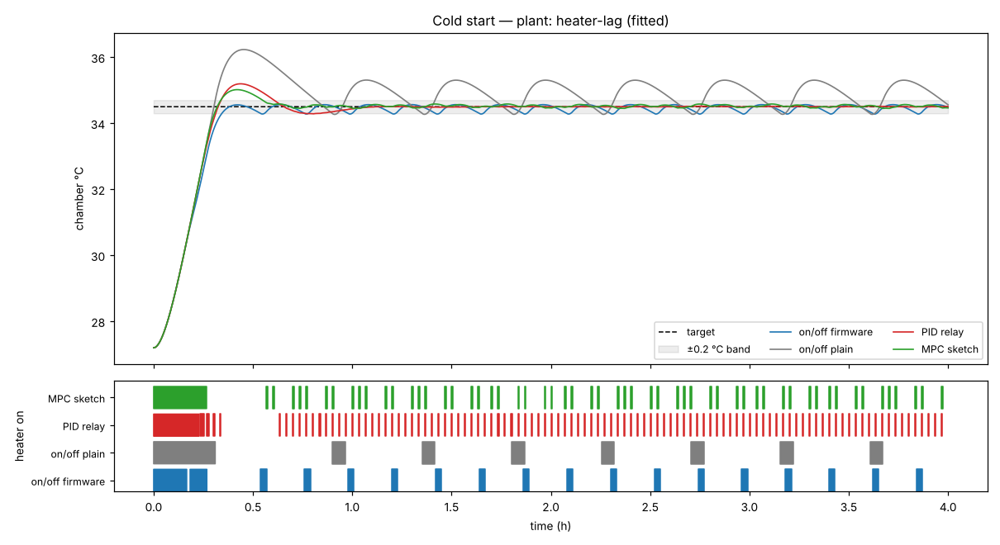
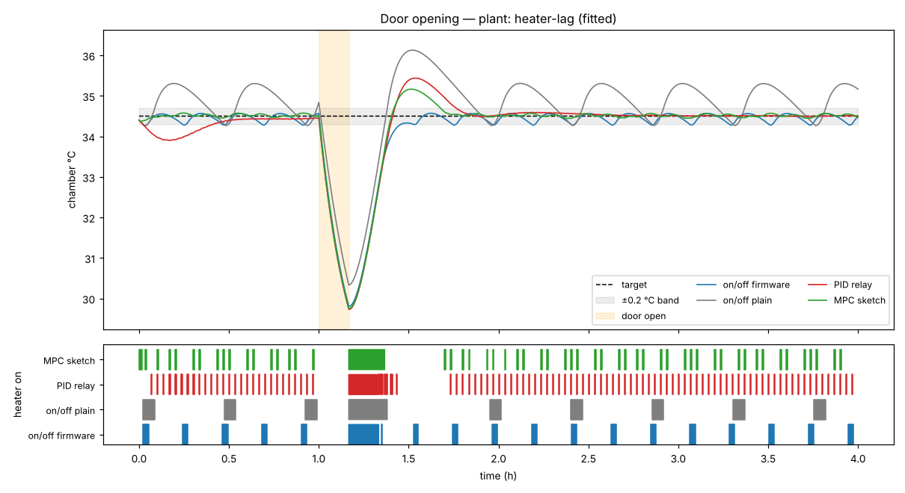
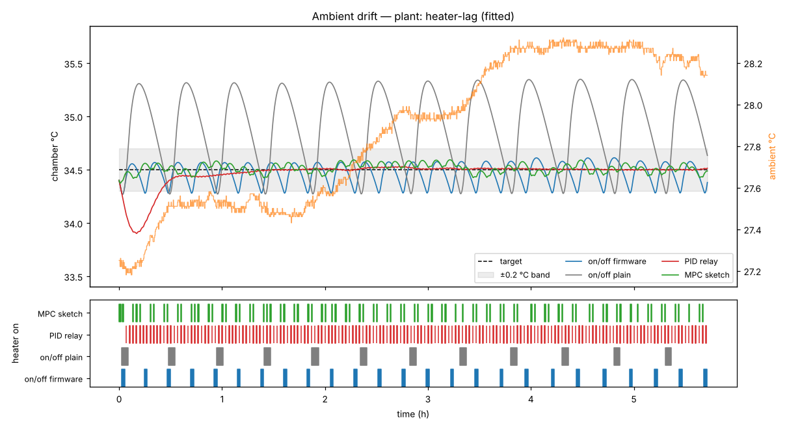
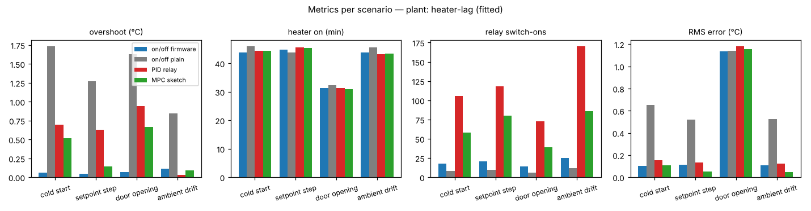
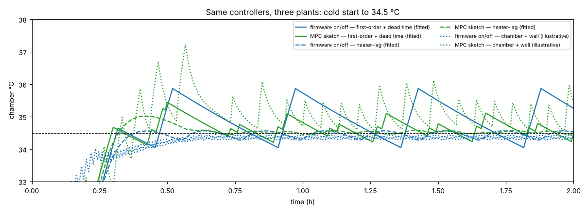
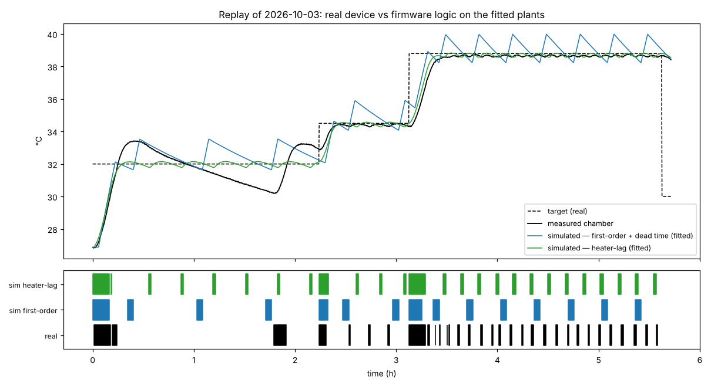
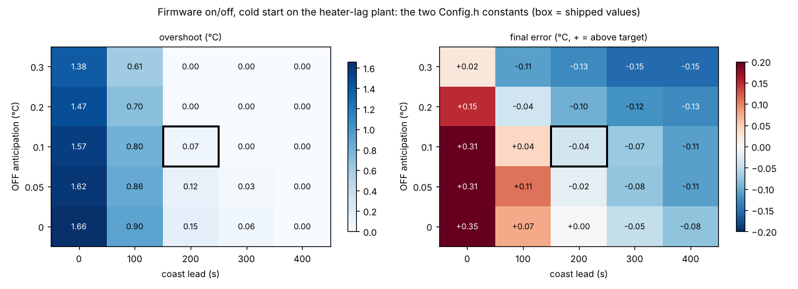

# incubator-thermal-control-sim

Simulation of a queen-bee incubator's heating as a first-order and a second-order thermal
model, with the parameters that [incubator-telemetry-analysis](https://github.com/Mariam-zeqred/incubator-telemetry-analysis)
fitted on one real day of telemetry, and a comparison of four heater controllers on the same
relay: the on/off logic of the real [queen-bee-incubator](https://github.com/Mariam-zeqred/queen-bee-incubator)
firmware (hysteresis with OFF-anticipation, a coast-lead prediction and a duty-cycle limit), a
plain thermostat, a PID quantised to relay pulses, and a model-predictive sketch. Every number
below is written by `scripts/make_figures.py` into `figures/results.json`; `make check`
regenerates all of it.

```
data/model_params.json  (a, b, τ_h fitted in repo #1)      data/incubator_2026-10-03.csv (real tempOut, targets)
            │                                                          │
            ▼                                                          ▼
   plant.py: first-order + dead time │ heater-lag │ chamber+wall   disturbances.py: ambient trace, door
            │                                                          │
            └──────────────► simulate.py (1 s loop + firmware interlock) ◄──────────────┘
                                       ▲                    │
            controllers/: firmware on/off │ plain │ PID relay │ MPC sketch      metrics.py
                                                            │
                        scripts/make_figures.py ──► figures/*.png, results.json
                        app/streamlit_app.py     ──► interactive page
```

## Run it

```bash
python -m venv .venv && source .venv/bin/activate
pip install -r requirements.txt
make check          # ruff + 41 pytest tests + regenerate figures/ (≈ 10–15 s)
make app            # Streamlit page: pick plant, scenario, controller settings
```

## What is simulated

**Plants** (`src/thermosim/plant.py`), all stepped at 1 s with heater command 0/1:

| model | equation | parameters | status |
|---|---|---|---|
| first-order + dead time | dT/dt = a·u(t−d) − b·(T − T_out) | a = 0.554 °C/min, b = 0.0101 /min (τ = 99 min), d = 210 s | fitted on 2026-10-03, RMSE 0.29 °C |
| heater-lag (second order) | dE/dt = (a·u − E)/τ_h ; dT/dt = E − b·(T − T_out) | a = 0.591, τ_h = 4.9 min, b = 0.0111 | fitted, RMSE 0.16 °C, the better model |
| chamber + wall | two capacities, air fast, wall slow | derived from a, b; wall share 0.7, air↔wall 8 min | **illustrative**, not fitted |

Only a = P/C and b = 1/(RC) are identifiable from temperature alone, so heater energy is
reported as heater-on minutes and as a × on-time (°C of heating delivered, proportional to
energy); the heater's wattage is not in the data.

**Controllers** (`src/thermosim/controllers/`):

- `FirmwareHysteresis` re-implements `Control.cpp` of the real firmware with its `Config.h`
  values (read from the public repo on 2026-10-14): ON below target − 0.2 °C; OFF when the
  *projected* temperature (reading + rate of rise over the last 60 s × 200 s coast lead)
  exceeds target + 0.2 − 0.1 °C anticipation; 30 s minimum OFF; after 600 s continuously ON a
  forced 60 s rest. The real trace confirms the constants: it switches on at target − 0.18…0.22 °C
  and its longest ON runs are exactly 600 s followed by a 45–60 s gap.
- `PlainHysteresis`: ON below target − 0.2, OFF above target + 0.2, nothing else.
- `PIDRelay`: PI tuned with Skogestad's SIMC rules on the first-order fit (kp = 0.258 /°C,
  Ti = 28 min), conditional-integration anti-windup, output turned into relay pulses by
  time-proportioning over a 120 s window with a 10 s minimum pulse.
- `MPCSketch`: every 120 s enumerates 5⁴ duty sequences over a 4-window horizon on the
  heater-lag model with its fitted gains (a = 0.591 °C/min, τ_h = 4.9 min, b = 0.0111 /min;
  the PID is tuned on the first-order fit because SIMC needs a dead time), cost =
  tracking² + 0.02·duty + 0.05·|Δduty|, applies the first move, and carries a bias term
  (measured − predicted) forward. Exhaustive search, no QP, no constraints beyond 0–1: a
  sketch of what knowing the model buys, not a deployable design.

The simulator applies the firmware's interlock outside every controller: heater off while the
door is open and a latched cut-off at 40 °C (re-armed 0.5 °C lower; the real firmware also
waits for an operator). The reading handed to the controller is quantised to 0.01 °C.

**Scenarios** (`src/thermosim/scenarios.py`): cold start from 27.2 °C to 34.5 °C (the day's
ambient and the firmware's default target); setpoint step 34.5 → 36.5 °C; door open for
10 min with the loss coefficient ×10 (illustrative: the real day's door stayed shut); ambient
following the real `tempOut` trace (27.2–28.3 °C over 5.7 h).

## Results on the heater-lag plant



| cold start, 4 h | to band (min) | overshoot (°C) | heater on (min) | switch-ons | in band | final error (°C) |
|---|---|---|---|---|---|---|
| on/off firmware | 20.6 | **0.07** | 43.9 | 18 | 83 % | −0.04 |
| on/off plain | 17.8 | 1.73 | 46.0 | **8** | 24 % | +0.35 |
| PID relay | 18.7 | 0.69 | 44.5 | 106 | 84 % | 0.00 |
| MPC sketch | 18.4 | 0.52 | 44.5 | 58 | 87 % | +0.01 |

| setpoint step +2 °C | to band (min) | overshoot | heater on | switch-ons | in band |
|---|---|---|---|---|---|
| on/off firmware | 9.1 | **0.04** | 44.9 | 21 | 84 % |
| on/off plain | 4.8 | 1.27 | 43.9 | 10 | 27 % |
| PID relay | 10.7 | 0.63 | 45.5 | 118 | 89 % |
| MPC sketch | 8.3 | 0.15 | 45.5 | 80 | **97 %** |





What the matrix supports (full numbers in `figures/results.json`):

- **Energy is not where controllers differ.** Within each scenario the four controllers' heater-on
  times agree to within 2.5 min (43.9–46.0 min on the 4 h cold start, 43.3–45.7 min over the 5.7 h
  ambient trace, 31.0–32.4 min in the 3 h after the door opening): at steady state the heater only
  replaces the loss b·(T − T_out), whatever switches it. The controllers differ in overshoot,
  band-holding and switching.
- **The firmware's on/off is the only controller with no overshoot on the fitted plant**
  (0.04–0.11 °C in every scenario) because its coast-lead projection switches off about 1.4 °C
  early during a heat-up (after the 600 s duty rest at 10 min, the projection first switches off
  at 33.1 °C for a 34.5 °C target); the plain thermostat overshoots 1.3–1.7 °C and then cycles
  between −0.2 and +0.8 °C of the target, as the chamber keeps warming for minutes after the
  relay opens.
- The firmware holds the band slightly **below** target (final error −0.04 to −0.07 °C): the
  projection is only ever added, never subtracted. The real day shows the same: the steady
  state at 38.8 °C sat 0.1–0.2 °C low.
- **PID** removes the offset (final error 0.00) but needs 5–7 times as many relay switch-ons
  (73–170 per run against the firmware's 14–25) because every 120 s window carries a pulse;
  raising the window reduces switching and widens the band.
- **MPC** gives the tightest tracking (RMS 0.05 °C on ambient drift, 97 % in band on the
  step) with 2.8–3.8 times the firmware's switching. It assumes a constant 27.2 °C ambient; giving it
  the measured trace is the extension in WALKTHROUGH.md.
- **Door opening**: a 10-minute opening drops the chamber 4.2–4.8 °C with every controller
  because the heater is interlocked off; the chamber is back in the band 12–18 min after the
  door closes, the firmware without overshoot, the thermostat with 1.6 °C.

## When the plant is not the one you tuned on



On the illustrative chamber+wall plant (air responds fast, wall drags) the ranking flips:
the firmware logic chatters (362 switch-ons in 4 h, held −0.14 °C low) because the fast air
keeps crossing its projected edge, the MPC sketch overshoots 2.7 °C because its internal model
is wrong, and the plain thermostat is the best of the four (0.23 °C overshoot, 121 switch-ons).
The lesson is not that one controller wins; it is that the model matters more than the
controller, which is why repo #1's fit exists.

## Replay of the real day



Feeding the real day's target schedule and ambient to the firmware logic on the fitted plants:

| | heater-lag plant | first-order + dead time | real device |
|---|---|---|---|
| overshoot on the first approach to 32 °C | 0.15 °C | 1.54 °C | **1.42 °C** |
| RMSE after the 34.5 °C step (2.24 h → end) | **0.21 °C** | 0.75 °C | — |
| heater duty over the day | 19.6 % | 20.2 % | 19.2 % |
| relay switch-ons | 26 | 15 | 32 |

Honest reading: the heater-lag plant reproduces the steady level and duty at 34.5 and 38.8 °C (held
0.0–0.2 °C low like the device; its pulses are ~10 min apart where the real ones are ~7 min) but
not the real 1.4 °C overshoot of the first approach; the dead-time plant reproduces that
overshoot and then saw-tooths from −0.5 to +1.4 °C around the target where the device held
within −0.2…0.0 °C. Neither model explains the first run from cold fully, and the hour from
1.0 to 2.2 h where the real chamber fell to 30.2 °C with the heater mostly off below target
cannot be simulated: the export has no field saying why the heater was blocked then. This is an in-sample check
(the plants were fitted on this day), not a validation on new data.

## What the real firmware does and why on/off is defensible

The relay is a solid-state switch with two states, the chamber has a 99-minute time constant
and the heater element a 5-minute lag. A proportional output on such a plant is only ever
"pulse width", which is what the firmware's 600 s / 60 s duty limit and the PID's
time-proportioning both are. Given that, the firmware's choices hold up in the simulation:
the ±0.2 °C band matches the sensor's 0.01 °C steps and the brood's tolerance, the
coast-lead projection removes the overshoot a plain thermostat has on this lagging plant, the
30 s minimum OFF and the duty rest bound relay wear and heater-on stretches, and the whole
thing runs with no model, no tuning constants beyond five numbers in `Config.h`, and
behaviour an operator can predict. Its known cost is a ~0.05 °C low bias and 14–25 switch-ons
per run; a PID would trade that for 73–170 switch-ons, an MPC for a model that must be right.

## Where the firmware's two constants sit



`sweep.py` runs the firmware logic on the cold start for every pair of its two `Config.h`
constants (OFF anticipation 0–0.3 °C × coast lead 0–400 s; grids in `results.json`). On the
heater-lag plant the coast lead does the work: at 0.1 °C anticipation the overshoot falls
1.57 → 0.80 → 0.07 → 0.00 °C as the lead goes 0 → 100 → 200 → 300 s, while anticipation alone
leaves 1.38 °C even at 0.3 °C. The lead is not free: past 200 s the final error grows from
−0.04 to −0.11 °C, time to band from 20.6 to 31.2 min and switch-ons from 18 to 26. The
shipped pair (0.1 °C, 200 s) is the first cell where the overshoot is below 0.1 °C and the
bias is still within the sensor's noise. On the first-order dead-time plant no pair helps
(overshoot 1.3–1.9 °C, bias +0.33…+0.69 °C): a 60 s rise-rate window cannot see through a
210 s dead time, which is the same story as the replay's first approach.

## Limitations

- One device, one day, fitted parameters with optimistic standard errors (see repo #1); the
  chamber+wall plant and the door loss ×10 are illustrative, not measured.
- Heater power unknown, so no kWh; `metrics.energy_kwh_at` converts for an assumed wattage.
- The MPC is an exhaustive-search sketch; the PID is PI with SIMC defaults, not hand-tuned.
- The sweep is on the cold start only; the real day's constants were chosen on the device.
- The Streamlit page was run headless in a test, not in a browser, in the sandbox.

## Next steps

See `TODO.md`: measure the heater's power, log a real door opening, explain the first-approach
overshoot, and give the MPC the ambient trace instead of a constant.

MIT licence. The data files come from the author's own device via incubator-telemetry-analysis.
